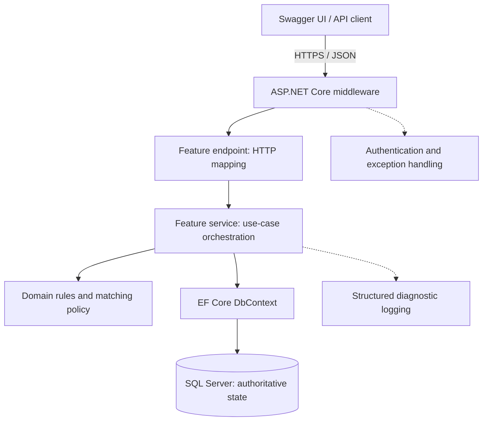
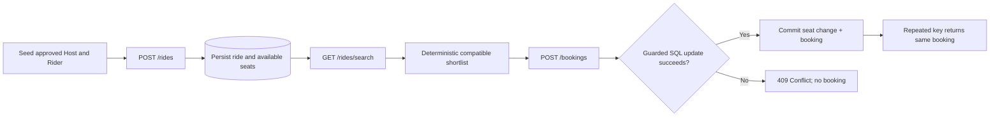
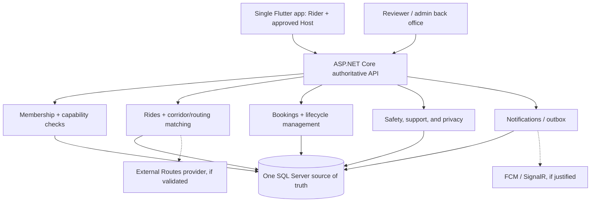

# Lamma — Backend Architecture & Implementation Planning Document

**Version:** 1.1 — Approved Credosis implementation baseline  
**Date:** 8 November 2026  
**Scope:** Three-endpoint backend demonstration; future Lamma product kept as a separate roadmap  
**Status:** **Decisions D-01 through D-08 resolved for the demo.** Changes require a recorded revision.  
**Authority key:** **Screening commitment** = explicitly submitted answer; **Demo decision** = approved engineering choice for this assessment; **Later product** = not implemented now.

---

# A. Overview

Lamma is a community-focused carpooling platform intended to help people in Egypt share compatible journeys, reduce the cost and inconvenience of fragmented transportation, and build trust within a controlled initial university community. The eventual product is one mobile application in which a member may ride and, after additional approval, also host. The backend is authoritative for permissions, ride availability, matching decisions, bookings, and durable records; it is not merely a storage API for the mobile application.

The **Credosis deliverable** is a small but complete backend demonstration of that business idea. Using **ASP.NET Core, C#, EF Core, and SQL Server**, it will show a Host publishing a ride (`POST /rides`), a Rider discovering compatible offers (`GET /rides/search`), and the Rider booking a seat without overbooking (`POST /bookings`). Swagger UI will drive the demonstration. The system must persist real database state, reject invalid and unauthorized actions, return predictable errors, and pass meaningful tests. No Flutter screen, AI model, live payment, real ID collection, third-party route service, cancellation, or Host acceptance workflow is required for this assessment. Each published demo ride offers exactly **three passenger seats**, excluding the Host.

**Architecture thesis (approved).** Use a single feature-organized ASP.NET Core application with **Minimal API feature groups**, direct EF Core persistence, focused services, and explicit business rules. Apply SOLID and separation of concerns where they improve reliability. Avoid CQRS, MediatR, generic repositories, microservices, separate read databases, and interfaces for every concrete class. The full Lamma product should extend this foundation in proven vertical slices rather than treat a three-endpoint assessment as the complete MVP.

**Source and authority note.** The screening answers establish the problem, three main entities (Users, Rides, Bookings), three primary endpoints, and initial technology choice. The 18 August Lamma blueprint supplies wider product boundaries (one app, approved Host capability, controlled corridor, deterministic matching, transactionally safe bookings). The 12 August lean-stack plan is an earlier reference, not a mandate to ship its entire stack. This document records the **approved demo decisions** and distinguishes them from separately proposed future product capabilities.

## A.1 Delivery boundaries

| In the Credosis demonstration | Designed for later Lamma product stages |
|---|---|
| One API deployment, SQL Server database, three primary business endpoints | One Flutter application with Rider and approved Host modes |
| Seeded synthetic accounts, short-lived signed development JWTs, and database-enforced permissions | University email verification; human Host/vehicle review |
| Ordered curated corridor/meeting nodes with deterministic matching and explicit intermediate-stop opt-in | Road-based detours, broader geography, calibrated ranking |
| Immediate confirmed one-seat booking; each ride starts with exactly 3 passenger seats | Potential Host-approved requests, cancellations, trip execution |
| Transaction-safe seat allocation, retry handling, unit and integration tests | Notifications, safety/privacy operations, support, mocked payments, controlled pilot |
| Swagger UI/OpenAPI documentation and 3–5 minute walkthrough | Full back office, monitoring, AI/data experiments, deployment hardening |

# B. High Level Design

## B.1 System shape and responsibility boundaries

Lamma follows a **feature-first modular monolith**. One process hosts the three main API operations; one SQL Server database owns canonical state. Group source by feature rather than splitting every responsibility into a separate assembly. **HTTP routing uses Minimal API route groups** with consistent tags, operation IDs, bearer security, response types, and XML/OpenAPI metadata. Internally, an endpoint maps HTTP requests to application results, a service coordinates one cohesive use case, domain rules validate business behavior, and EF Core persists it. Middleware provides shared cross-cutting concerns, such as authentication and structured error handling.



**Responsibility contract**

| Component | Owns | Must not own |
|---|---|---|
| Middleware / shared API setup | Authentication integration, correlation IDs, safe exception formatting, OpenAPI configuration | Ride-specific rules or seat transactions |
| `RideEndpoints` / `BookingEndpoints` | HTTP binding, request-level validation, invoking services, translating results into status codes | SQL queries, matching calculations, business decisions |
| `RideService` / `BookingService` | Use-case coordination, authorization/resource checks, transaction boundaries where necessary | HTTP response construction or provider-specific UI logic |
| `RideMatcher` | Eligibility, corridor/stop ordering, time-window fit, deterministic explanation/order | HTTP handling, authentication tokens, SQL connection management |
| Domain models and rules | Valid states and invariants; clear names for domain concepts | Framework or routing-specific concerns |
| `AppDbContext` / entity configurations | EF Core mappings, indexes, constraints, persistence | Product policy decisions |
| SQL Server | Referential integrity, unique indexes, guarded seat changes, atomic commit | Authorization or product interpretation on its own |

This is **not** strict Clean Architecture: services may depend directly on `AppDbContext`. Constructor injection is retained, but interfaces are introduced only where there is a justified substitution or boundary. Do not equate SRP with one method per class.

## B.2 Approved repository and folder organization

```text
Lamma/
├── Lamma.sln
├── src/
│   └── Lamma.Api/
│       ├── Features/
│       │   ├── Users/
│       │   │   ├── User.cs
│       │   │   └── UserConfiguration.cs
│       │   ├── Rides/
│       │   │   ├── Ride.cs
│       │   │   ├── RideEndpoints.cs
│       │   │   ├── RideService.cs
│       │   │   ├── RideContracts.cs
│       │   │   ├── RideConfiguration.cs
│       │   │   └── Matching/
│       │   │       └── RideMatcher.cs
│       │   └── Bookings/
│       │       ├── Booking.cs
│       │       ├── BookingEndpoints.cs
│       │       ├── BookingService.cs
│       │       ├── BookingContracts.cs
│       │       └── BookingConfiguration.cs
│       ├── Data/
│       │   ├── AppDbContext.cs
│       │   ├── SeedData.cs
│       │   └── Migrations/
│       ├── Common/
│       │   └── ErrorHandling/
│       ├── Program.cs
│       └── appsettings.json
├── tests/
│   └── Lamma.Tests/
│       ├── Unit/
│       └── Integration/
├── docs/
│   ├── planning/
│   └── decisions/
└── README.md
```

This is an **intended layout, not a list of files to create before they are needed**. The diagram uses the **selected** Minimal API route groups. Controllers are not part of this demo. Each file is created when its feature becomes necessary. `MeetingNode` and its configuration can live under `Rides/Geography/` once implemented. Keep feature-specific DTOs and EF mappings near the feature; share only genuine cross-cutting infrastructure.

## B.3 Data model and invariants

The three **core business entities** are `User`, `Ride`, and `Booking`. Pilot lookup tables, such as `MeetingNode`, support geographic constraints; they do not change the screening's three-entity business model. **Every published ride is fixed at three passenger seats**, with exactly one seat taken by each successful booking. Do not keep verified identity documents or real credentials in sample data.

| Entity | Proposed minimum fields | Rules and constraints |
|---|---|---|
| `User` | Id, display name, membership state, Host approval state, account state | A user may be both Rider and Host. A client-selected UI mode never authorizes a Host operation. |
| `MeetingNode` (supporting lookup) | Id, corridor, travel direction, route order, active state, public meeting-point label | Only approved nodes appear in published rides. A node sequence represents curated pilot geometry, **not road routing**. |
| `Ride` | Id, HostId, origin/destination node IDs, departure UTC, seat capacity (=3), available seats (initially 3), intermediate-stop permission, status | Exactly 3 passenger seats; 0 ≤ available ≤ 3; future departure; valid ordered nodes; approved Host; server owns the capacity setting. |
| `Booking` | Id, RideId, RiderId, seats (=1), status, idempotency key, request fingerprint, created UTC | One passenger seat per booking; valid FKs; unique Rider/Ride booking (no cancellation in demo); unique Rider/key; immutable request fingerprint. |

**Suggested relationships:** `User (Host) 1—many Ride`; `User (Rider) 1—many Booking`; `Ride 1—many Booking`; `MeetingNode 1—many Ride (as origin/destination)`. Add SQL unique constraints and appropriate indexes (Host/ride status/time; corridor/direction/time; Rider/Ride; Rider/idempotency key). Add database CHECK constraints for `SeatCapacity = 3`, `0 <= AvailableSeats <= 3`, and `Booking.Seats = 1` so incorrect application code cannot silently violate this demo policy. Store UTC in the database and convert for Egyptian local display at the client boundary.

**Demo states (locked):** `Ride = Published | Full`; `Booking = Confirmed` after successful `POST /bookings`. A published ride becomes `Full` when the third passenger seat is reserved, as part of the same atomic database operation. No cancel, rebook, expire, complete, or Host-approval transition is exposed in this demo. Extended states belong to the separate product roadmap.

## B.4 Matching semantics — precise and honest

**Approved controlled-corridor rule (D-02):** each curated meeting node belongs to a specific pilot corridor and travel direction, with a known order. A ride can match a Rider only when both requested nodes are on that same ordered corridor, the pickup comes before the drop-off, the Host's offered range contains the Rider's requested range, and the Host explicitly allows intermediate stops (otherwise exact origin/destination is required). The departure must fall within the requested bounded time window; capacity and eligibility checks come first. **A passenger reserves one seat for the entire journey**, even if their pickup/drop-off span is shorter. The demo does not reuse a vacated seat for a later route segment. This is **node/corridor matching, not live detour or arbitrary route-overlap matching**.

1. Reject inactive or disallowed users and invalid node pairs before searching.
2. Select `Published` rides on the correct corridor and direction with at least one currently available passenger seat, a valid future departure, and an approved current Host.
3. Apply departure bounds and exact-node or opt-in ordered-stop inclusion rules. Exclude the Rider's own published rides.
4. Sort deterministically by closest departure-time fit, then departure UTC, then Ride ID; apply a small bounded result limit.
5. Return factual explanations (e.g., `CORRIDOR_COMPATIBLE`, `DEPARTURE_WITHIN_WINDOW`), not an invented AI score or an unverified detour estimate.

Search is a **read-time snapshot**. A result showing available seats is not a reservation. The booking endpoint must re-evaluate capacity atomically and may return `409 Conflict` if another Rider took the seat first. No external route API is needed for the demonstration.

## B.5 Endpoint 1 — `POST /rides` (Host publishes a ride)

**Purpose:** let an approved Host publish an upcoming offer with an approved route segment and valid capacity.

**Request (locked):** `originNodeId`, `destinationNodeId`, `departureAtUtc`, `allowsIntermediateStops`. **No `seatCapacity` parameter**: the backend sets `SeatCapacity = AvailableSeats = 3`; unknown capacity/seat fields are rejected in this demo contract. Host identity is taken from the authenticated principal, **never from a client-supplied HostId**.

**Happy-path response:** `201 Created`, containing ride ID, canonical state (`Published`), departure time, `seatCapacity: 3`, and `availableSeats: 3`. A real `Location` URL is supplied only if a resource lookup endpoint exists; otherwise do not fabricate one.

```mermaid
sequenceDiagram
    participant C as Swagger / Host
    participant E as RideEndpoint
    participant S as RideService
    participant DB as SQL Server
    C->>E: POST /rides + bearer token + JSON
    E->>E: Bind and validate request shape
    E->>S: CreateRide(authenticatedUser, input)
    S->>DB: Check current Host permission + nodes
    DB-->>S: Active/approved + valid corridor
    S->>S: Enforce departure, capacity, state rules
    S->>DB: Insert Published Ride; save
    DB-->>S: New ride ID and persisted seats
    S-->>E: Created ride result
    E-->>C: 201 Created + documented JSON
```

**Failures:** `400` invalid request, `401` unauthenticated, `403` not approved/suspended Host, `409` business conflict if applicable, `500` sanitized unexpected failure. Invalid node references must not silently create unknown locations.

## B.6 Endpoint 2 — `GET /rides/search` (Rider finds compatible rides)

**Purpose:** return a stable shortlist of published, compatible rides, with explainable reasons. **Query (illustrative):** `pickupNodeId`, `dropoffNodeId`, `fromUtc`, `toUtc`; requested seats are **implicitly one** (no `seats` query parameter). Reject inverted or overly broad date windows. Authenticated Rider identity is server-derived.

**Happy-path response:** `200 OK`, a bounded list of ride summaries with departure UTC, permitted pickup/drop-off nodes, currently reported seats, and match reasons. An empty result is `200 OK []`, not an error.

```mermaid
sequenceDiagram
    participant C as Swagger / Rider
    participant E as SearchEndpoint
    participant S as RideService
    participant M as RideMatcher
    participant DB as SQL Server
    C->>E: GET /rides/search?pickup...&dropoff...&from...&to...
    E->>E: Validate query window and seats
    E->>S: SearchRides(authenticatedUser, criteria)
    S->>DB: Check membership; fetch bounded SQL candidate set
    DB-->>S: Published, permitted, seat/time/corridor candidates
    S->>M: Apply exact or ordered-stop matching and ranking
    M-->>S: Eligible shortlist + reason codes
    S-->>E: Search results
    E-->>C: 200 OK + results (possibly empty)
```

**Failures:** `400` invalid nodes/time/query, `401` unauthenticated, `403` membership restricted, `500` sanitized unexpected failure. A result's seat count is explicitly non-binding until `POST /bookings` succeeds.

## B.7 Endpoint 3 — `POST /bookings` (Rider claims a seat)

**Purpose:** persist exactly one valid confirmed booking for an eligible Rider while ensuring final-seat contention never overbooks the ride.

**Request (locked):** `{ "rideId": "..." }`, plus a required `Idempotency-Key` HTTP header unique to the Rider's logical attempt. **A booking always claims exactly one seat**, derived on the server; do not accept a `seats` field. The Rider ID comes from the authenticated principal. For the three-endpoint demo, **immediate confirmation is approved (D-01)**; Host approval requires additional transitions/endpoints and is explicitly a separate product decision.

**Concurrency rule:** a normal `SELECT seats` followed by an unguarded update is unsafe. Start a short SQL transaction, verify relevant eligibility and duplicate/idempotency state, execute a **single conditional seat decrement by one** (`AvailableSeats > 0` and status `Published`), update ride status to `Full` when the result is zero, insert the booking with a unique scoped idempotency key, then commit. If the decrement affects zero rows, do not create a booking. If a uniqueness constraint fails, roll back and resolve whether this is an identical retry or conflicting duplicate. All operations must use the **same transaction**; never decrement and insert in independent commits.

```mermaid
sequenceDiagram
    participant C as Swagger / Rider
    participant E as BookingEndpoint
    participant S as BookingService
    participant DB as SQL Server
    C->>E: POST /bookings + Idempotency-Key
    E->>S: Book(authenticatedUser, rideId, seats, key)
    S->>DB: Begin short transaction; check eligibility and replay
    alt Same logical request already committed
        DB-->>S: Existing booking
        S-->>E: Return existing booking (no new debit)
    else New booking attempt
        S->>DB: Guarded UPDATE: decrement one if available > 0
        alt One ride row updated
            S->>DB: INSERT Confirmed Booking (1 seat) + key/fingerprint
            S->>DB: COMMIT
            DB-->>S: Persisted booking
            S-->>E: Confirmed booking
        else No row updated
            S->>DB: ROLLBACK
            S-->>E: Seat unavailable / ride no longer eligible
        end
    end
    E-->>C: 201 first success; 200 identical replay; 409 conflict
```

**Atomicity note:** SQL Server may serialize contending writes or one request may fail due to a unique-key conflict. Both outcomes must be mapped to truthful API responses. Tests must use real SQL Server rather than relying on EF InMemory/SQLite to prove SQL Server locking behavior. An idempotency key is scoped to the authenticated Rider and stored on the booking together with the request fingerprint (`POST /bookings` + canonical `rideId` + one seat). The first commit returns `201`; an identical retry returns the **same booking** with `200`, even if the ride is now full; reuse of the same key with a different ride returns `409`. A different key from the same Rider to the same Ride is `409 DUPLICATE_BOOKING`. Concurrent same-key requests must resolve the unique-key collision by rolling back and re-reading the committed booking; neither may decrement capacity twice. Keys are required, nonempty, bounded to 128 characters, and documented in Swagger.

**Failures:** `400` invalid request/key, `401` unauthenticated, `403` forbidden/self-booking/restricted user, `404` inaccessible/nonexistent ride where safe, `409` insufficient seats, duplicate active booking, inactive ride, or key conflict; unexpected failure becomes a sanitized `500` without exposing SQL internals.

## B.8 Authentication, authorization, errors, and operational boundaries

**Approved demo identity approach (D-03):** protected endpoints must receive a verifiable authenticated principal. Use **synthetic, locally seeded Rider and approved/unapproved Host accounts** with signed, expiring **development-only JWT bearer tokens** and Swagger's **Authorize** action. Prefer the official `dotnet user-jwts` workflow to mint local tokens; the exact tooling must be tested against our seed IDs and token validation settings. Do **not** trust arbitrary `X-User-Id` or `HostId` headers. At each protected operation, the API looks up the authenticated subject in SQL Server and checks its **current** account/capability state. Token roles alone do not grant current Host approval. A production-ready university onboarding/authentication flow is **not** part of this assessment. Host approval in the demo is fixture state, not proof of identity review. Keep demonstration signing secrets out of source control and ensure no demo token configuration is usable in a live environment.

**Validation layers:** request contracts enforce required fields/ranges; feature services enforce user/ride business rules; domain methods enforce meaningful state invariants; SQL constraints preserve integrity even during concurrent access. Central error handling produces consistent Problem Details (`type`, `title`, `status`, `detail` when safe, `traceId`, stable business `code`). Avoid exception-driven normal control flow for expected business conflicts.

**Observability:** log request correlation, endpoint, outcome code, and safe IDs; exclude credentials, tokens, precise private mobility points, and real identity evidence. Add a basic health endpoint or internal health check only when it improves setup/demo reliability; it is not one of the three product endpoints. Swagger/OpenAPI provides named/tagged **Minimal API feature groups** (`Rides`, `Bookings`), operation summaries, typed request/response schema, bearer-JWT Authorize, the required `Idempotency-Key` header, and documented `200`/`201`/`400`/`401`/`403`/`404`/`409`/`500` responses as applicable. Expose Swagger UI and OpenAPI only in Development or a separately controlled Demo environment. Prefer environment-gating the interactive UI to development or controlled demo deployment.

## B.9 End-to-end behavior in one glance



## B.10 Quality gates and acceptance criteria

| ID | Acceptance evidence |
|---|---|
| AC-01 | Approved Host can publish a valid ride; unapproved user gets `403`. |
| AC-02 | Invalid direction, node order, or departure time is rejected; any attempted client-supplied `seatCapacity` is not accepted. Created rides always have 3 seats. |
| AC-03 | Search returns only corridor/direction/time/stop/seat-eligible offers and predictable ordering; no-match is `200 []`. |
| AC-04 | Rider cannot book their own ride or an inactive offer; each successful booking claims exactly one passenger seat, and the third booking marks the ride Full. |
| AC-05 | After two distinct Riders book the first two seats, two more distinct Riders racing for the **third/final seat** produce exactly one booking and one truthful `409`, never four reservations. |
| AC-06 | Retry after a committed-but-lost response with the same key returns the same booking; capacity changes once. |
| AC-07 | Same key with different payload or duplicate active Rider/Ride booking is rejected without double-decrement. |
| AC-08 | Data survives service restart and the expected EF migrations reproduce the schema on a clean SQL Server database. |
| AC-09 | Swagger UI groups all three endpoints by feature, documents JWT bearer security, one-seat booking, Idempotency-Key and response codes, and supports a complete reviewer walkthrough. |
| AC-10 | Unit and SQL Server integration tests pass from documented commands; logs/errors do not leak secrets. |

## B.11 Future product extension map — architecture, not immediate work

The **graduation/product architecture** retains the same one-application and one-authoritative-backend principle. Additional modules should be introduced behind specific capabilities, not because the prototype needs to look extensive. The mobile client remains a single Flutter app; switching between Rider and Host mode is a presentation choice, not a server authorization grant.



| Future module | Responsibility | Condition for introduction |
|---|---|---|
| Membership and capabilities | Account identity, supported university-email verification claims, explicit revocable Host access | Real users beyond seeded technical-demo accounts |
| Host and vehicle review | Separate human decisions, approved vehicle linkage, expiry, evidence protection | Actual onboarding of Hosts and vehicles |
| Meeting nodes and routing | Curated corridors first; road detour checks and provider quotas only when route variation requires them | Geographic matching cannot be represented honestly by curated stops |
| Booking lifecycle | Request/accept/reject, withdrawal, cancellation, seat release, disputed outcomes | Product workflow approved and backed by state-transition tests |
| Notifications and recovery | Durable in-app events and canonical REST refresh; outbox for reliable dispatch | Asynchronous communication is actually added |
| Safety, privacy, operations | Human reports/review, role-limited access, evidence retention and recovery | Controlled real-user pilot, institutional/policy review |
| Payment and AI/data | Mock/waived payments; separate evaluated OCR and clustering experiments | Explicit graduation/business needs and approved evidence/data policy |

**Product expansion rule:** none of these future dependencies should be imported into the three-endpoint Credosis code merely as placeholders. We can preserve stable feature naming and well-defined responsibilities today; interfaces and infrastructure arrive when real integration begins. Pilot readiness must be assessed separately and should not be inferred from a successful Swagger demonstration.

## B.12 Exact scope for the reviewer demonstration

The three business endpoints intentionally stand alone. A seed utility or documented `dotnet user-jwts` commands are **developer tooling**, not public product APIs; OpenAPI JSON and Swagger UI are documentation endpoints, not extra carpooling features. No `GET /rides/{id}`, `GET /bookings/{id}`, token-issuance API, or cancellation endpoint is required to show a full create–search–book cycle. The initial `POST /rides` response supplies the ride ID, `GET /rides/search` shows its availability, and `POST /bookings` returns the canonical booking.

**Suggested 3–5 minute evidence path:** (1) identify three Minimal API operations and bearer authorization in Swagger; (2) create a future ride as an approved Host and show `availableSeats: 3`; (3) search from an eligible Rider and show explainable matching; (4) book a seat and show Confirmed; (5) retry with the same key to show identical ID and no second decrement; (6) demonstrate full-capacity `409` and show passing real-SQL concurrency test output. Do not claim that a Swagger exercise alone demonstrates concurrency—use automated test evidence.

# C. Implementation Steps

Implement one **complete vertical slice at a time**. Each phase has an exit condition and becomes reviewable before the next phase. The roles/owners remain unassigned; this is a solo Credosis demonstration unless the user explicitly delegates tasks.

## Phase 0 — Requirements lock and architecture record

**Concern:** prevent ambiguous business logic from being baked into database tables. **Steps:** adopt the approved D-01–D-08 register; freeze immediate confirmation, ordered-node matching, seeded development JWTs, Minimal API feature groups, three-seat rides, one-seat bookings, idempotency rules, and explicit deferrals. Record ADR-001 (feature-first monolith), ADR-002 (matching), ADR-003 (booking), ADR-004 (seat atomicity/idempotency), and ADR-005 (dev-only identity). Fix practical query bounds as implementation defaults, not commercial product policies. **Exit:** signed-off endpoint schemas and acceptance tests; **no unresolved architecture blockers** for Phase 1.

## Phase 1 — Project foundation and documentation

**Concern:** make the project build and communicate its behavior before implementing features. **Steps:** create one .NET 10 LTS ASP.NET Core Web API project and one test project; establish `Features`, `Data`, `Common`, and `docs/decisions` directories. Configure dependency injection, environment-specific settings, structured logging, OpenAPI generation, interactive Swagger UI, and centralized Problem Details. Implement **Minimal API route groups** using named operations, feature tags, typed response metadata, bearer security, and Swagger UI Try It Out; endpoint behavior must stay thin in both approaches. **Exit:** an empty, reproducibly buildable service with accessible OpenAPI/Swagger UI and consistent error middleware.

## Phase 2 — SQL Server schema and curated pilot fixtures

**Concern:** establish durable and enforceable data invariants. **Steps:** create `User`, `Ride`, and `Booking` entities with EF Core mappings, relations, check constraints, unique indexes, UTC timestamps, and migrations. Add curated active corridor/meeting-node fixtures and separate synthetic approved Host, unapproved Host, and at least four Rider identities. Enforce **SeatCapacity = 3**, initial `AvailableSeats = 3`, and single-seat bookings using app rules plus SQL constraints. Define seed routines that are clearly development-only and reproducible, without handling real university records. **Exit:** clean database migration applies; sample users and node order exist; persistence/restart checks pass.

## Phase 3 — Host publishing (`POST /rides`)

**Concern:** let only approved Hosts publish valid capacity-bearing offers. **Steps:** define request/response DTOs; implement a thin endpoint and a cohesive `RideService`; validate current Host approval, ride node order/corridor and future departure; set capacity/availability to **3** on the server and persist the published ride. Document status codes and add unit/integration tests for valid and invalid scenarios. **Exit:** Swagger can publish a ride, read the returned ID/capacity, and reliably reject unapproved users or invalid routes.

## Phase 4 — Matching (`GET /rides/search`)

**Concern:** produce a real and explainable compatible shortlist. **Steps:** add bounded query DTO validation; pre-filter efficiently in SQL for corridor, status, time, **at least one remaining seat**, and current Host eligibility; apply `RideMatcher` for exact-node/ordered-stop policy and deterministic ranking; return factual reason codes. Measure the candidate query and avoid a full-database in-memory scan. **Exit:** independently seeded positive, negative, and boundary cases produce the expected ordered results and empty responses.

## Phase 5 — Safe booking (`POST /bookings`)

**Concern:** prevent duplicate reservations and race-condition overbooking. **Steps:** define `{ rideId }` booking contract and required `Idempotency-Key`; verify Rider authorization and resource rules; use a short SQL Server transaction with conditional **one-seat** decrement, atomic transition to `Full` when zero, and booking insertion; enforce unique booking/idempotency constraints; handle conflicts and rollback explicitly. **Exit:** confirmed booking persists, repeated identical request returns the same ID with `200` (including when the ride is full), different payload under the same key conflicts, and the **third-seat** concurrency test passes repeatedly.

## Phase 6 — API hardening and automated verification

**Concern:** prove behavior rather than relying on happy-path manual requests. **Steps:** add domain/matcher unit tests, integration tests against a disposable SQL Server instance, request validation tests, authorization tests, duplicate/replay tests, and concurrency stress cases. Confirm exception-to-Problem-Details mapping, structured safe logs, cancellable async I/O, reasonable search bounds, and migration reproducibility. **Exit:** all acceptance criteria AC-01 through AC-10 have recorded passing evidence; no untested claims of correctness.

## Phase 7 — Delivery and the 3–5 minute Credosis demonstration

**Concern:** make the engineering decisions understandable to a reviewer. **Steps:** finish README (prerequisites, local SQL Server setup, migration, seed, run, test, Swagger URL, synthetic account identities, token-generation instructions), add a small architecture and API overview, and prepare a deterministic Swagger walkthrough: show the three endpoints, one successful end-to-end journey, one invalid/forbidden request, one full-seat conflict, and a brief clip of automated concurrency test evidence for the third seat. The video must not pretend that advanced routes, university verification, or cancellations are live. **Exit:** fresh-checkout reproducibility and a video that illustrates working behavior without claiming deferred features are implemented.

## Phase 8 — Evolution into the full Lamma product (separate roadmap)

**Concern:** expand only when the graduation/product requirement demands it. **Steps:** add real university membership with supported verification claims; separate Host/vehicle review and durable capability revocation; richer node/route data and measured detour checks; request/accept/cancel state transitions; notifications and canonical REST recovery; trip execution and limited location sharing; human-operated safety/privacy tools; mocked payment ledger; then separately governed AI/data experiments. Each capability must get a bounded vertical slice, authorization rules, audit needs, and tests before a pilot. **Exit:** individual feature acceptance gates and a separate institutional pilot readiness review, **not** automatic production qualification based on the Credosis demo.

# D. External Libraries and Dependencies

| Component | Purpose | Integration / decision |
|---|---|---|
| .NET 10 LTS / ASP.NET Core | Runtime and HTTP API | Single Web API application; use an actively supported LTS release. |
| EF Core SQL Server provider | ORM and migrations | `AppDbContext` directly, scoped per request; no generic repository wrapper. |
| Microsoft SQL Server | Canonical database and transactional integrity | Real SQL Server used for concurrent booking integration tests. |
| Microsoft.AspNetCore.OpenApi | Generate OpenAPI schema | Built-in API documentation; Swagger UI is a separate development/demo integration. |
| Swagger UI | Interactive Credosis demonstration | Add only the UI integration needed to inspect/test the three endpoints. |
| ASP.NET Core JWT authentication / DI / Problem Details | Signed demo identity, current SQL permission checks, wiring, safe errors | Approved dev-only JWT strategy, Swagger Authorize; never production credentials or real identity evidence. |
| xUnit or equivalent .NET test framework | Unit and integration verification | One test project, grouped by behavior; real SQL Server for transaction claims. |
| SQL Server container or local developer instance | Disposable repeatable DB for tests | Choose based on development machine capability and licensing. |
| Google Routes / FCM / OCR / payments / SignalR | Later product capabilities | **Not included in the Credosis executable**; integrate only behind a justified boundary later. |

**Authoritative implementation references (official):**

- Microsoft .NET support policy: https://dotnet.microsoft.com/en-us/platform/support/policy
- Microsoft ASP.NET Core OpenAPI: https://learn.microsoft.com/en-us/aspnet/core/fundamentals/openapi/overview?view=aspnetcore-10.0
- Microsoft Minimal API endpoint groups and metadata: https://learn.microsoft.com/en-us/aspnet/core/fundamentals/minimal-apis?view=aspnetcore-10.0
- Microsoft developer JWT tool: https://learn.microsoft.com/en-us/aspnet/core/fundamentals/minimal-apis/security?view=aspnetcore-10.0
- Microsoft ASP.NET Core API error handling: https://learn.microsoft.com/en-us/aspnet/core/fundamentals/error-handling-api?view=aspnetcore-10.0
- Microsoft EF Core transactions: https://learn.microsoft.com/en-us/ef/core/saving/transactions
- Microsoft SQL Server locking and row versioning: https://learn.microsoft.com/en-us/sql/relational-databases/sql-server-transaction-locking-and-row-versioning-guide

**Project source documents:** `Lamma_Complete_System_Blueprint.md` (18 August 2026), `one_app_lean_architecture.md` (12 August 2026), user's submitted Credosis screening answers, and the C++ Rate Limiter / Job Scheduler planning documents (format reference).

# E. Decision Register — Approved for the Credosis Demo

**Decision date:** 8 November 2026. Every D-01–D-08 is **resolved for implementation**. “Deferred” is an intentional scope decision, not a missing implementation task. Changes require updating the affected contract, migration, test, and diagram before development.

| ID | Decision | Approved outcome | Implementation consequence |
|---|---|---|---|
| D-01 | Booking confirmation | **Immediate Confirmed** for each successful booking; no Host acceptance. | `POST /bookings` persists `Confirmed` directly. No pending/approval statuses. |
| D-02 | Matching resolution | **Curated directional corridor, ordered meeting nodes, explicit intermediate-stop opt-in**; no live road routing. | `RideMatcher` performs deterministic hard filters and factual reasons only. |
| D-03 | Demo authentication | **Seeded synthetic user accounts and signed expiring development JWTs**. | Swagger Authorize; server derives user from validated token and rechecks SQL user permissions. |
| D-04 | Endpoint style | **Minimal APIs grouped by business feature**. | Thin `RideEndpoints`/`BookingEndpoints`; OpenAPI tags, schemas, named operations and documented errors. |
| D-05 | Capacity and booking size | **Exactly three passenger seats per ride** (Host excluded); **one passenger seat per booking**. | Server-fixed 3, no client capacity/seats parameter; `AvailableSeats` 3→2→1→0, then `Full`. |
| D-06 | Idempotency | **Required Rider-scoped key**; initial success `201`, identical replay `200`, key/payload mismatch `409`. | Persist key + fingerprint with booking; unique constraints; atomic guarded update + insert; race-safe replay. |
| D-07 | Cancellation and rebooking | **Deferred entirely for Credosis**. | No cancel/rebook endpoint, seat restoration, or related state transitions. |
| D-08 | Advanced product scope | **Deferred**: third-party routing, real university verification, vehicle review, payments, notifications, safety workflows, AI. | None enter runtime/dependencies; reserved for future reviewed vertical slices. |

## E.1 Baseline implementation defaults (not new product decisions)

- **One corridor and two directions:** direction is part of the approved meeting-node catalogue. Seed at least four ordered nodes in one direction and representative reverse-direction nodes for negative tests. Node sequence is curated, not a road graph.
- **Search inputs:** `pickupNodeId`, `dropoffNodeId`, `fromUtc`, `toUtc`; a bounded UTC window, ordered limits, and a finite maximum result count (initial conservative defaults: **maximum 2-hour window and 20 results**). No `seats` parameter because seat demand is always one in the demo.
- **Ride creation:** `originNodeId`, `destinationNodeId`, `departureAtUtc`, `allowsIntermediateStops`; backend sets `seatCapacity = 3` and `availableSeats = 3` unconditionally.
- **Booking creation:** `{ "rideId": "..." }` and `Idempotency-Key`; server derives `riderId` from the JWT and `seatsBooked = 1` from the policy. Validated keys are nonempty, up to 128 characters. Use a freshly generated UUID string per new logical attempt and **reuse it for network retries**.
- **HTTP documentation:** group routes under Rides/Bookings without changing the three original public paths; `POST /rides`, `GET /rides/search`, `POST /bookings`. Swagger UI demonstrates authentication and failures without requiring a fourth business endpoint.
- **Database constraints:** fixed ride capacity, bounded availability, one-seat booking, Rider/Ride uniqueness, Rider/Idempotency-Key uniqueness, referential integrity, indexes for candidate search. Seeded accounts are synthetic and development-only.
- **Clock/test control:** UTC persistence and a framework `TimeProvider` for deterministic time-bound tests. Status `Full` is set atomically when capacity reaches zero.

## E.2 Frozen endpoint contracts (v1.1)

| Operation | Input / identity | Successful response | Primary failure cases |
|---|---|---|---|
| `POST /rides` | JWT approved Host; JSON `originNodeId`, `destinationNodeId`, `departureAtUtc`, `allowsIntermediateStops`; **no capacity field** | `201` ride: ID, segment, timestamp, state Published, capacity 3, available 3 | `400` malformed/invalid route/time; `401` no token; `403` not approved |
| `GET /rides/search` | JWT active Rider; query pickup/dropoff nodes and bounded `fromUtc`/`toUtc` | `200` sorted list, including `[]`, with permitted metadata, available seats, factual reason codes | `400` invalid criteria; `401` no token; `403` inactive member |
| `POST /bookings` | JWT active Rider; JSON `rideId`; required `Idempotency-Key` | `201` initial Confirmed booking; `200` identical replay returning same booking ID | `400` bad request/key; `401` no token; `403` self-book; `404` unknown ride; `409` full/duplicate/key mismatch |

**Suggested stable error codes:** `VALIDATION_FAILED`, `HOST_NOT_APPROVED`, `MEMBERSHIP_INACTIVE`, `RIDE_NOT_FOUND`, `SELF_BOOKING_FORBIDDEN`, `RIDE_NOT_BOOKABLE`, `SEATS_UNAVAILABLE`, `DUPLICATE_BOOKING`, `IDEMPOTENCY_KEY_REUSED`. Respond with RFC 9457-compatible Problem Details and a safe `traceId`. Unexpected exceptions are sanitized.

## E.3 Idempotency and last-seat truth table

| Situation | Result | Seat effect |
|---|---|---|
| New Rider/key/ride with one seat available | `201 Created`; Confirmed booking | Exactly −1; transition to Full if final seat |
| Same Rider + same key + same ride, even after capacity reaches 0 | `200 OK`; return original booking ID | **0 additional seats** |
| Same Rider + same key + a different ride | `409 IDEMPOTENCY_KEY_REUSED` | 0 |
| Same Rider + same ride + a different key | `409 DUPLICATE_BOOKING` | 0 |
| Two different Riders compete for the third/final seat | One `201`, one `409 SEATS_UNAVAILABLE` | Exactly −1 in total |
| Booking insert/transaction fails after seat update | Error response or mapped conflict after rollback | **0 persisted seat change** |
| Two concurrent identical requests with same key | One `201`; other resolves to original `200` after winner commits | Exactly −1 in total |

**Transaction order:** authenticate subject and validate request → resolve committed identical replay first → begin short DB transaction → check current Rider/Ride and uniqueness eligibility → conditional update decrementing one seat only if `Published` and `AvailableSeats > 0` (set `Full` at zero) → insert uniquely keyed Confirmed booking → commit. Handle unique-key collisions with rollback and a bounded reread. **A retry must not fail just because its original request consumed the final seat.**

## E.4 Acceptance checklist for implementation handoff

- [ ] Project builds from a fresh checkout, OpenAPI JSON is valid, Swagger UI exposes the three named and tagged operations.
- [ ] Seeded synthetic Host and Riders can obtain verifiable dev JWTs; unapproved Host cannot publish.
- [ ] `POST /rides` creates exactly three available passenger seats; no capacity override can enter the contract.
- [ ] `GET /rides/search` distinguishes direction, ordered stops, opt-in intermediate stops, departure window, available seats, and excluded own ride.
- [ ] Three distinct Riders book one seat each; the third booking makes the ride Full; fourth is `409`.
- [ ] Parallel last-seat booking, same-key retry, key misuse, and duplicate Rider/Ride tests pass against **real SQL Server**.
- [ ] All failures are documented Problem Details; database state survives restart and migration setup.
- [ ] README contains environment setup, seed IDs, dev-token creation, request examples, test commands, and a 3–5 minute video walkthrough.
- [ ] No deferred feature is presented as implemented or added as placeholder infrastructure.

**Next implementation action:** Phase 1 — create the solution, Minimal API project, test project, feature directories, OpenAPI/Swagger UI, error handling and dev-only authentication configuration. Start domain/migration work only after the solution builds and the documented authentication/demo mechanism is exercised.
